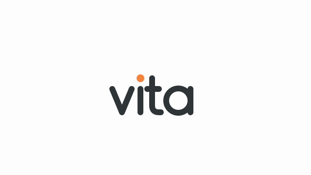

<p align="center"></p>

# Vita

**에이전트 세션 기반 업무 관리.** Claude Code·Codex 세션 기록으로 내 업무를 정리하는 로컬 웹앱. 주간 계획 → AI 코딩 도구로 진행 → 주간·월간 보고까지 한 곳에서.

> A local web app (macOS · Windows) that turns your Claude Code and Codex session history into a weekly task board, calendar, AI-written reports and agent-usage analytics. Everything stays on your machine (`127.0.0.1`). UI is in Korean.

Claude Code(`~/.claude/projects`)와 Codex(`~/.codex/sessions`)의 세션 원본을 10분마다 읽어 **내 DB 에 옮겨 적고**
(Claude Code 는 원본을 30일 뒤 지웁니다), 그 작업들을 **내가 세운 할 일**에 붙여 정리합니다. Codex 가 Claude Code 에서 가져온 세션은 겹쳐 세지 않습니다.

## 할 수 있는 것

| 메뉴 | 내용 |
|---|---|
| **업무** `/` | 주·월 할 일(카테고리별 블록, 상태·우선순위·마감·메모), 지난주 이월, 할 일에 안 붙은 "계획 외 작업" |
| **세션** `/sessions` | 1년 잔디, 작업 시간·사용량 카드, 주·월 캘린더(며칠 이어진 세션은 막대로), 세션 목록(할 일별 묶기) |
| **리포트** `/report` | AI 주간·월간 업무 보고서(기본 + 직접 만든 양식), 사내 주간보고용 글(전체 + 직접 만든 요약 갈래), 모델별 토큰·API 환산 비용 |
| **AI 사용** `/ai` | 에이전트 옵저버 — 도구 실패율·대기·컨텍스트 압축·비용 같은 지표와 병목, 개선 규칙을 `CLAUDE.md`·메모리에 넣고 전후 효과 측정 |
| **설정** `/settings` | 카테고리(이름·순서·색), 폴더 → 카테고리, 반복 업무 세션(배포 등), 리포트 양식, 주간보고 갈래, AI 작성 도구(Claude Code / Codex) |

사이드바엔 지금 열려 있는 Claude Code 세션이 카테고리별로 보입니다. 세션 목록에서 Codex 세션엔 `Codex` 표시가 붙습니다.

## 설치

### Claude Code · Codex 에 맡기기 (가장 쉬움)

Claude Code 나 Codex 를 열고 이렇게만 말하세요.

```
https://github.com/dkflfkd53/vita 받아서 AGENTS.md 안내대로 설치해줘
```

저장소의 [`AGENTS.md`](AGENTS.md)(Claude Code 는 `CLAUDE.md` 가 이걸 불러옴) 안내대로 운영체제 확인 → 필요한 프로그램 확인(없으면 물어보고 설치) → 받기 → 빌드·자동 시작 등록 →
카테고리·폴더 연결 같은 첫 설정까지 대화로 같이 해 줍니다.

### 직접 설치

| | macOS | Windows 10/11 |
|---|---|---|
| Java 21 이상 | `brew install --cask temurin@21` | `winget install EclipseAdoptium.Temurin.21.JDK` |
| Node.js 20 이상 | `brew install node` | `winget install OpenJS.NodeJS.LTS` |
| git | `xcode-select --install` | `winget install Git.Git` |
| AI 코딩 도구 | 로그인된 `claude`(Claude Code) 또는 `codex`(Codex CLI) — 요약·리포트가 **내 구독**으로 돈다 | 〃 |
| 설치 | `./install.sh` | `powershell -ExecutionPolicy Bypass -File .\install.ps1` |
| 자동 시작 | launchd(로그인 시) | 작업 스케줄러(로그인 시), 막히면 시작 프로그램 바로가기 |
| 제거 | `./uninstall.sh` | `.\uninstall.ps1` |

```bash
git clone https://github.com/dkflfkd53/vita.git
cd vita
./install.sh                                              # macOS
powershell -ExecutionPolicy Bypass -File .\install.ps1    # Windows (PowerShell)
```

끝에 `실행 중: http://127.0.0.1:4100` 이 나오면 브라우저로 엽니다. 처음 빌드는 의존성을 내려받느라 몇 분 걸립니다.
코드를 받아 고친 뒤(`git pull` 포함) 설치 스크립트를 다시 돌리면 새 버전으로 교체·재시작됩니다. 리눅스는 아직 자동 시작 스크립트가 없습니다.

> Windows 지원은 새로 넣은 것이라 실제 Windows 에서 아직 충분히 검증되지 않았습니다. 설치가 막히면 Claude Code 에 오류를 보여 주거나 이슈로 남겨 주세요.

### 처음 설정

**설정** 화면에서:

1. **카테고리** — 할 일을 묶을 큰 단위(예: 프로젝트 A / 프로젝트 B / 기타)와 색
2. **폴더 → 카테고리** — 어느 폴더 아래에서 연 세션을 어느 카테고리로 볼지. 폴더 경로(`~/work/회사A`)를 적으면 그 아래 저장소·하위 폴더가 전부 따라오고 가장 가까운 폴더 규칙이 이깁니다. 저장소 이름만 적어도 됩니다. 비워 두면 전부 저장소 이름 그대로 보여 줍니다
3. (선택) **반복 업무 세션** — 배포처럼 늘 돌리는 세션은 계획 외 작업에서 빼고 짧은 이름·색으로
4. (선택) **리포트 양식** — 회사 월간·주간 보고 양식(마크다운 틀)과 제목을 넣으면 리포트 화면에 버튼이 생기고, 세션 기록으로 그 틀을 채웁니다. 범위를 카테고리로 좁히거나 작성 지침을 더할 수 있어요
5. (선택) **주간보고 갈래** — "전체 업무 내용" 말고 특정 카테고리·키워드·저장소만 짧게 뽑는 요약. AI 지시와 문체 예시를 적을 수 있고, 직접 고친 글은 다음 주 AI 작성의 예시가 됩니다
6. (선택) **AI 작성** — 요약·리포트를 Claude Code(`claude -p`)로 쓸지 Codex(`codex exec`)로 쓸지

그다음 **업무**에서 이번 주 할 일을 적고, 할 일을 펼쳐 "+ 세션 추가"로 열려 있는 Claude Code 세션을 붙이면 됩니다.

로그 `~/.claude-worklog/logs/worklog.log` (Windows 는 `%USERPROFILE%\.claude-worklog\logs`)

## 데이터와 개인정보

- 서버는 **127.0.0.1 에만** 열립니다. 외부로 보내는 건 없고, AI 호출은 내 컴퓨터의 `claude -p`(도구 끔) 또는 `codex exec`(읽기 전용)뿐이며 둘 다 세션을 저장하지 않습니다.
- 기록은 `~/.claude-worklog/worklog.db`(SQLite) 한 파일. **요청 원문이 들어 있으니 외부에 올리지 마세요.**
- 모으는 것: 세션 제목·작업 시간, 내 요청 원문(앞 2,000자), 수정한 파일 경로, 도구 호출(이름·명령 앞부분·걸린 시간·실패), 토큰 사용량, git 커밋 제목(`--author=<git user.name>`).
- 모으지 않는 것: Claude 답변·생각, 도구 출력, 파일 내용.
- 작업 시간 = 세션 이벤트 간격 15분 이하 구간의 합(추정치). 비용 = API 단가로 환산한 추정치(구독 요금과 다름, 단가는 `application.yml` 의 `worklog.pricing` — Codex(OpenAI) 모델은 기본 단가표에 없어 토큰만 보이니, 쓰는 모델의 단가를 거기에 더하면 금액도 나옵니다).

### 백업

- 매일 12:30 스냅샷 → `~/.claude-worklog/backups/worklog-YYYY-MM-DD.db.gz` (14일·8주·12개월 보관). 사이드바 "백업" 버튼 = 지금 백업
- **macOS**: 같은 파일을 openssl AES-256(PBKDF2) 로 암호화해 iCloud Drive `Worklog-backup` 에 한 부 더. 암호는 키체인 `worklog-backup` —
  `./backup-password.sh` 로 확인해 따로 보관하세요. 되돌리기 `./restore.sh` (새 맥: clone → `./install.sh` → `./restore.sh "<.enc 파일>"`)
- **Windows**: 로컬 백업만(암호화 사본 없음 — 필요하면 backups 폴더를 OneDrive 등에 직접 복사). 되돌리기 `powershell -ExecutionPolicy Bypass -File .\restore.ps1`

## 구조

- `back/` Spring Boot 4 · Java 21 · SQLite(JdbcClient) — 수집(`collect`·`usage`·`agent`), 조회·연결(`query`·`work`), 리포트(`report`·`summary`), 설정(`config`)
- `front/` React 19 · Vite 7 · TypeScript · TanStack Query — 빌드 결과를 jar 가 그대로 서빙
- `claude-skill/worklog-publish` 리포트 HTML 을 claude.ai 아티팩트로 올리는 Claude Code 스킬(선택)
- `install.sh`·`install.ps1` 설치·자동 시작, `AGENTS.md` AI 코딩 도구용 설치·개발 안내(`CLAUDE.md` 가 불러옴)

화면 이름은 Vita 지만 데이터 폴더(`~/.claude-worklog`)·launchd(`com.worklog.server`)·자바 패키지(`com.worklog`) 이름은 worklog 그대로입니다.

개발: `cd back && ./gradlew bootRun` + `cd front && npm run dev`(5173 → `/api` 는 4100 으로 프록시). 테스트 `cd back && ./gradlew test`.

## 라이선스

MIT
